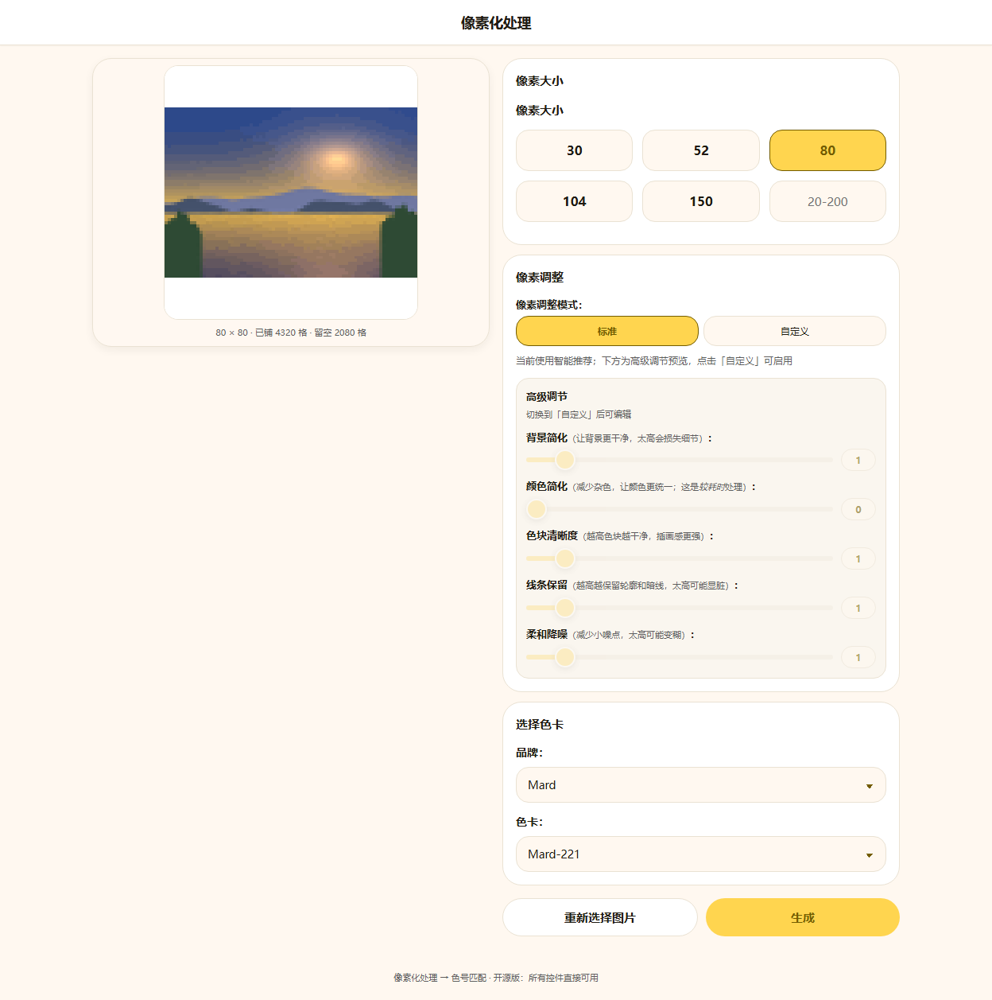
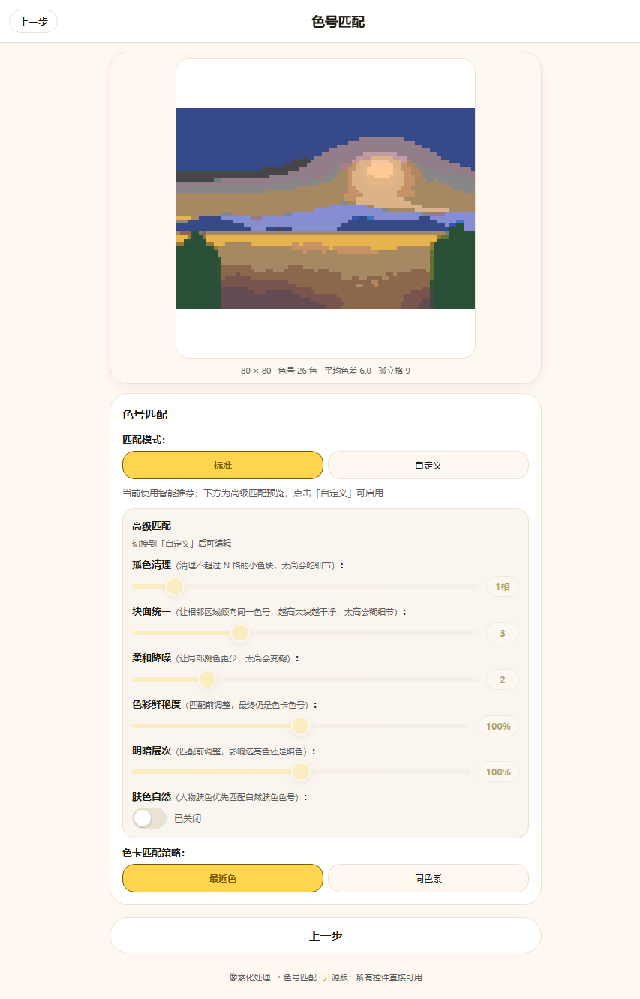

# pindou-bead-pattern

[中文](README.md) | English

A **two-step** web tool that turns a photo into a perler / fuse-bead（拼豆, Perler / Hama bead）pattern:

1. **Pixelation（像素化处理）** (downsampling) — choose an image, choose a pixel size, choose a palette, and preview the pixelated result live
2. **Color code matching（色号匹配）** — snap the pixelated result onto a real palette to get a bead pattern with color codes

Those are the only two steps: no editor, no export, no AI generation, no paywall.

| Step 1: Pixelation | Step 2: Color code matching |
| --- | --- |
|  |  |

(The screenshots use the built-in sample scene + the Mard 291 palette at 80 cells; the non-proportional regions outside the square board are left blank, not stretched.)

## Quick Start

```bash
git clone https://github.com/YOUR_GITHUB_USERNAME/pindou-bead-pattern.git
cd pindou-bead-pattern

npm install
npm run dev        # http://127.0.0.1:5310
```

```bash
npm run build      # outputs dist/
npm run preview    # preview the build
```

Requires Node ≥ 20.19 (or ≥ 22.12, following Vite 8). There is no backend — all computation happens in the browser, and images are never uploaded anywhere.

## What the Two Steps Do

### Step 1: Pixelation（像素化处理） (structure layer)

Image → downsample to a **square board** of "pixel size × pixel size" → region merge → color simplification → sampling enhancement → spatial smoothing.
The output is a pixel grid that **has not yet been snapped to a palette** (each cell is an arbitrary HEX color).

- The size model is a **square board（方板）**: the number of cells is always `pixel size²`; the source image is scaled proportionally and centered, and the non-proportional regions are left blank
  — letterboxing（方板留白）, rendered as white. So the preview in this step is a square.
- 标准（Standard）= the smart recommended preset (values chosen automatically by size tier); 自定义（Custom）= 5 sliders layered on the standard baseline:
  背景简化（background simplification）, 颜色简化（color simplification）, 色块清晰度（block clarity）, 线条保留（line retention）, 柔和降噪（soft denoise）.

### Step 2: Color code matching（色号匹配） (match layer)

On the grid from step 1: grayscale detection → exact nearest color (CIEDE2000 + k-d tree) → 块面统一（block unification） → 匹配层平滑（match-layer smoothing）
→ 杂色清理（speckle cleanup, i.e. 去杂色）. The output is the **color code（色号）** of each cell (such as `C29`) plus usage statistics.

- 标准（Standard）= the smart recommended preset; 自定义（Custom）= manually adjust 去杂色（speckle cleanup）, 匹配层平滑（match-layer smoothing）, 块面统一（block unification）, 鲜艳度（vividness）, 明暗层次（light/dark gradation）.

Changing a step-2 preset re-runs step 2 only; changing a step-1 parameter re-runs step 1 (and if you are currently on step 2, then re-runs step 2 as well).

### What Values "Standard" Actually Takes

标准（Standard） is not a fixed set of parameters; values are chosen automatically by pixel-size tier. The tier boundaries are
`< 64` → small, `< 104` → medium, `< 150` → large, `≥ 150` → xlarge:

| Pixel size | Structure layer: 背景简化（background simplification） / 颜色简化（color simplification） / 色块清晰度（block clarity） / 线条保留（line retention） / 柔和降噪（soft denoise） | Match layer: 去杂色（speckle cleanup） / 匹配层平滑（match-layer smoothing） / 块面统一（block unification） |
| --- | --- | --- |
| 20-52 | 2 / 2 / 2 / 2 / 1 | 1 / 1 / 2 |
| 53-63 | 2 / 0 / 2 / 2 / 1 | 1 / 1 / 2 |
| 64-103 | 1 / 0 / 1 / 1 / 1 | 1 / 2 / 3 |
| 104-149 | 0 / 0 / 1 / 1 / 0 | 3 / 3 / 4 |
| ≥ 150 | 0 / 0 / 0 / 0 / 0 | 2 / 2 / 3 |

Small sizes need more simplification (fewer cells, so noise is relatively more visible); large sizes are essentially handed back to the algorithm itself.
鲜艳度（vividness） and 明暗层次（light/dark gradation） are always 1.0 in standard mode, and 肤色保护（skin-tone protection） is always off.

## Palette Data

**This repository contains no brand palette data at all**, and ships only 4 built-in synthetic palettes (17 / 40 / 152 / 300 colors),
so a fresh clone runs as-is (in that case the 152-color palette, which has the most colors, is selected by default).

This page exposes exactly one brand palette, **Mard 291**: if it can be found in the external data, it is the only one offered,
and no other brand palette or built-in synthetic palette ever enters the selection list (when only one option remains, the UI writes it as a line of text
rather than showing a dropdown with a single item). To swap or add a brand palette, see
[`public/palettes/README.md`](public/palettes/README.md): put a directory that follows the
[pindou-color-data](https://github.com/HansBug/pindou-color-data) convention in place,
point `PINDOU_COLOR_DATA_ROOT` at it and the dev server mounts it under `/palettes/*`.

The provenance and correctness of palette data are the user's own responsibility — color codes（色号） and color values differ between manufacturers and between batches.

## Directory Structure

```
src/
├── algorithm/
│   ├── chain.mjs              # main imaging chain (mechanically extracted from the App page, then trimmed)
│   ├── stages.mjs             # the two entry points: runStructureStage / runMatchStage
│   ├── palette-source.mjs     # palette facade (built-in synthetic + external brand palettes)
│   ├── palettes.mjs           # built-in synthetic palettes
│   ├── color-data.node.mjs    # Node-side reader for external palettes (used by the dev server)
│   ├── image.mjs              # image decoding
│   └── sample-scene.mjs       # built-in sample scene
├── components/                # UI components for the two steps
└── render.mjs                 # canvas drawing
scripts/smoke.mjs              # end-to-end smoke run (both steps, no browser)
test/                          # node:test tests
```

## Algorithm Provenance and Verification

`src/algorithm/chain.mjs` was **mechanically extracted** from the `smart-pixel-generator` page of the 趣拼豆 App:
only `this.` in the page methods was replaced with `ctx.` from a module-level context; the algorithm logic was not touched.
The extraction performed these checks:

- The function bodies of the main-chain functions were **compared line by line** against the source file and are completely identical (the extraction script carries its own back-comparison);
- Runtime facilities the page does not have (`uni.*`, canvas 2D, page data/computed) are filled in with **platform stubs**;
  the canvas stub is a pure-JS implementation (including bilinear resampling), so this algorithm also runs in Node.

After extraction, to leave only the code the **two-step flow actually reaches** in the repository, a further **735 lines** were deleted (21.5% of the extraction result).
There is only one principle: **delete only code that is proven unreachable in this two-step flow or whose feature was removed wholesale**,
and never touch any algorithm branch that affects the result.

| Deleted content | Lines | Reason |
| --- | --- | --- |
| Legacy downsampling pipeline `pixelizeImageData` + the switch that selects it | 141 | The switch is hardcoded to "always use the new pipeline", so that branch can never be entered |
| One-shot orchestration `generatePixelArt`, `regenerateFromPixelization` | 155 | This repository splits the calls into two steps and no longer needs them |
| Preset system `applyPresetConfig` / `getPresetDescription` / `updateDescription` | 118 | There is no call site for them in the source page either |
| Drawing `drawResult` and this layer's `doDrawResult` stub | 63 | This repository draws directly to a DOM canvas from `src/render.mjs` |
| Dithering `applyDithering` / Floyd–Steinberg / Atkinson / `calculateGradients` / `addError` | 147 | Removed together with its UI entry point; see the reason below |
| `applyTestColorQuantizationRgb`, used only by a high preset | 28 | Only triggered when the region merge level is ≥10; a leftover from the test page |
| Thin feature-analysis wrappers `analyzeImage` / `analyzePalette` / `shouldSkipFeatureAnalysis`, `isSkinTonePixelCached`, `finishPerformanceTrace` | 59 | The `image-analyzer.js` they depend on was not carried over; measured call count at runtime is 0 |
| Cleanup of the call sites and branches left over from the above | 24 | |

**How we confirmed "deleted but the result did not change"**: the same set of scenarios was run before and after the deletion (standard mode at 52/96/150/200 cells,
custom structure presets, custom match presets, same-hue-family priority, grayscale images, an 8-color small palette), comparing item by item the
**structure grid fingerprint, matched color-code fingerprint, color count, mean color difference, and isolated bead count** — every item is **completely identical** except for the one case below,
with 0 per-cell differences in matched color codes. "Nobody actually calls this" was confirmed by wrapping every method and getter in the main-chain context with a
counter, running the full flow, and reading the call counts.

The only case that changed: when the **structure sliders are maxed out** (background simplification 10 → region merge level 12), the original code ran one extra pass of the
color normalization used by the test page; after deleting it, the same image goes from 23 colors / mean color difference 6.04 / 3 isolated cells to
20 colors / 5.68 / 0 cells (by the two proxy metrics this repository uses, that is an improvement). Every other preset is identical cell by cell.

`stages.mjs` splits the main chain into the source page's two steps and calls them. The split **does not change the result**: compared with "running it all at once",
the match result's RGBA and color codes have **0 per-cell differences** at 48 and 96 cells.

```bash
node --test                    # algorithm tests for both stages
node scripts/smoke.mjs 96      # runs both steps with a real palette and prints measured numbers
```

### Self-Check in the Browser

Open `?autotest=1` (for example <http://127.0.0.1:5310/?autotest=1>): the page automatically loads the built-in sample scene,
runs both steps, and writes the measured data into `<pre id="autotest" data-status="ok">`. You can confirm the pipeline is healthy without opening the console:

```
structure=52x52  occupied=1872  empty=832  structureElapsedMs=155
match=52x52  colors=21  mean=6.62  median=6.02  max=19.19  isolated=8  matchElapsedMs=50
```

(Color count, color difference, and isolated beads are deterministic values, the same on any machine; `*ElapsedMs` fluctuates with the machine and browser and is for reference only.)

When `data-status` is `error`, the node carries the error message; uncaught errors on the normal interaction path are also shown as a banner at the top of the page.

## Differences from the Original Page

This is a version that **extracts only the two steps** from the App page (upload → downsample → next → palette matching);
nothing else was carried over. So that people who have seen the original page are not misled, the differences are listed here:

**Removed**: the VIP gate (both 标准（Standard） and 自定义（Custom） modes are directly usable here), the pixel editor,
export (PNG / PDF blueprints), AI generation, cloud APIs, the artwork gallery and history, the various cache layers, and
dithering (Floyd–Steinberg / Atkinson) — measured on finished bead patterns it only adds high-frequency noise
(isolated beads（孤立豆） rise from 11 cells to 350 cells at 96 cells) while taking 3.5× longer, and the original page had no UI entry point for it anyway.

**Added**, things the original page does not have:

- **The `?autotest=1` self-check node**: see the previous section; it is convenient for confirming the pipeline is not broken when there is no test framework.
- **The `?testdrive=1` interaction self-check**: clicks each control in turn and asserts that "the result really was recomputed", to catch "fake controls";
  it runs only when that parameter is present, so normal use has zero overhead.

**Kept identical**: the algorithm itself, the order of the two steps and the ability to step back, the value table that tiers the standard preset by pixel size,
the UI copy (including wording from the original page such as 孤色清理（isolated color cleanup） and 肤色自然（natural skin tone）), square-board letterboxing（方板留白: leaving non-proportional
regions blank instead of stretching them）, and the 350ms debounce semantics of the step-1 sliders.

## Known Trade-offs

- Three presets — 柔和降噪（soft denoise, `noiseSmooth`） in the structure layer, plus 匹配层平滑（match-layer smoothing） and 块面统一（block unification） in the match layer —
  measured **make almost no difference even at maximum**: they judge whether "the neighborhood's dominant color is in the majority", but before that point region merge
  has already flattened the flat regions, so the dominant color is the cell itself. The UI keeps these controls (consistent with the original page),
  but do not expect a visible effect. What really works is **孤色清理（isolated color cleanup）** (去杂色): it brings isolated beads (cells whose four neighbors are all a different color) down from
  about 1.4% to about 0.2%, at the cost that the color difference of the cells whose color is forcibly changed becomes larger.
- The structure layer's spatial smoothing is essentially a no-op as long as the clustering / region merge level is not changed (measured: it affects only 4 cells).

## Contributing

See [CONTRIBUTING.md](CONTRIBUTING.md) (written in Chinese). In one line: do not commit brand palette
data, and any change to the algorithm needs a before/after comparison.

## License

[MIT](LICENSE). This repository contains no brand palette data.
